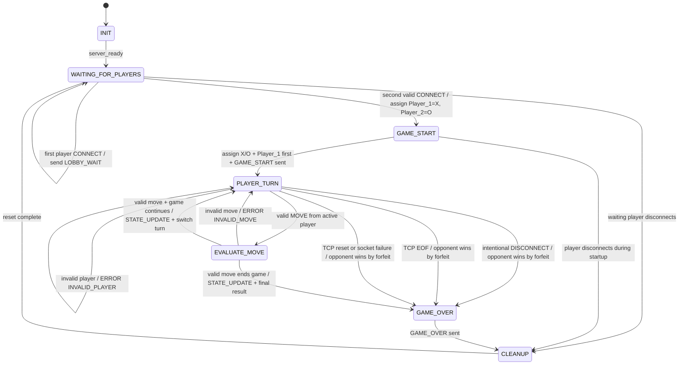

# Sprint 1: Game State Machine (FSM) Specification

## 1. Purpose

This document defines the server-side finite state machine for the turn-based two-player game.

The required server states are:

- `INIT`
- `WAITING_FOR_PLAYERS`
- `GAME_START`
- `PLAYER_TURN`
- `EVALUATE_MOVE`
- `GAME_OVER`
- `CLEANUP`

The server is authoritative. Client messages are inputs to the FSM; clients do not directly change the server's state.

Sprint 0 fixes the player roles: the first client is always `Player_1` with symbol `X` and moves first; the second client is always `Player_2` with symbol `O`.

## 1.1 Sprint 0 Game Rules Carried Forward

The FSM implements the Sprint 0 Tic-Tac-Toe rules:

- The board is a 3x3 grid.
- Player 1 uses `X` and moves first.
- Player 2 uses `O` and moves second.
- Players alternate turns.
- A move is rejected without losing the turn when the coordinates are invalid or the selected cell is already occupied.
- A player wins immediately after placing three matching symbols in a horizontal, vertical, or diagonal line.
- A draw occurs when all 9 cells are occupied without a winner.
- An unexpected or intentional client disconnect during an active game gives the remaining player a win by forfeit.


---

# 2. State Definitions

## INIT

The server process has started and is preparing the listening socket and game-state data structures.

**Responsibilities:**

- Create/bind/listen on the TCP socket.
- Initialize player slots.
- Initialize the board and scores.
- Set the FSM to `WAITING_FOR_PLAYERS`.

**Exit condition:** Server initialization completes.

---

## WAITING_FOR_PLAYERS

The server is accepting player connections but does not yet have two active players.

**Responsibilities:**

- Accept incoming TCP connections.
- Process `CONNECT` messages.
- Register the first player.
- Send `LOBBY_WAIT` to the first player.
- Reject or close additional connections if the room is already full.
- Detect clean EOF and socket failures.

**Exit conditions:**

- Second valid player connects → `GAME_START`.
- Waiting player disconnects → `CLEANUP`.

---

## GAME_START

Exactly two players have been registered.

**Responsibilities:**

- Assign the players to `Player_1` and `Player_2`.
- Initialize or reset the board.
- Initialize scores for the new game.
- Assign `X` to Player 1 and `O` to Player 2.
- Set Player 1 as the starting/active player because Sprint 0 requires Player 1 to move first.
- Send `GAME_START` to both clients.
- Prepare the active turn.

**Exit conditions:**

- Setup succeeds → `PLAYER_TURN`.
- A player disconnects before setup completes → `CLEANUP`.

---

## PLAYER_TURN

The server waits for a move from the player whose turn is active.

**Responsibilities:**

- Receive and frame protocol messages.
- Accept `MOVE` only from the active player.
- Reject out-of-turn `MOVE` messages with `ERROR(OUT_OF_TURN)`.
- Reject malformed/unknown messages with `ERROR`.
- Accept `DISCONNECT` and treat it as a forfeit during an active game.
- Detect TCP EOF and socket exceptions.

**Exit conditions:**

- Valid `MOVE` from active player → `EVALUATE_MOVE`.
- Invalid/out-of-turn input → remain in `PLAYER_TURN`.
- Intentional `DISCONNECT` → `GAME_OVER`.
- TCP EOF / reset / broken pipe / aborted connection → `GAME_OVER`.

---

## EVALUATE_MOVE

The server validates and applies the received move.

**Responsibilities:**

- Validate row/column types.
- Validate board bounds.
- Validate whether the selected location/action is legal.
- Apply the move to authoritative server state.
- Update scores if the game rules require it.
- Determine whether the game has ended.

**Exit conditions:**

- Invalid move → send `ERROR(INVALID_MOVE)` → `PLAYER_TURN`.
- Valid move and game continues → send `STATE_UPDATE` → `PLAYER_TURN`.
- Valid move ends game → send `STATE_UPDATE`, then `GAME_OVER`.

---

## GAME_OVER

The game has a final outcome.

**Responsibilities:**

- Determine final result as `WINNER`, `DRAW`, or `FORFEIT`.
- Include final scores.
- Send `GAME_OVER` to the affected clients.
- Prevent further moves from changing the completed game.

**Exit condition:** Final result has been sent and the server is ready for cleanup.

---

## CLEANUP

The server releases game/connection resources and prepares for another round.

**Responsibilities:**

- Remove disconnected player sockets.
- Clear player registrations as appropriate.
- Reset turn state.
- Reset or reinitialize board/game data for the next round.
- Close sockets that are no longer valid.
- Return the server to a usable lobby state.

**Exit condition:** Cleanup complete → `WAITING_FOR_PLAYERS`.

---

# 3. Mermaid State Diagram



---

# 4. Transition Logic

| Current state | Event | Condition | Action | Next state |
|---|---|---|---|---|
| `INIT` | Server ready | Socket initialized | Initialize game state | `WAITING_FOR_PLAYERS` |
| `WAITING_FOR_PLAYERS` | `CONNECT` | First player | Register player, send `LOBBY_WAIT` | `WAITING_FOR_PLAYERS` |
| `WAITING_FOR_PLAYERS` | `CONNECT` | Second player | Register player 2 | `GAME_START` |
| `WAITING_FOR_PLAYERS` | EOF/error | Player leaves | Remove player resources | `CLEANUP` |
| `GAME_START` | Setup complete | Two players present | Assign roles, choose starter, send `GAME_START` | `PLAYER_TURN` |
| `GAME_START` | Disconnect | Any player leaves | Clean invalid session | `CLEANUP` |
| `PLAYER_TURN` | `MOVE` | Correct active player | Pass move to evaluator | `EVALUATE_MOVE` |
| `PLAYER_TURN` | `MOVE` | Wrong player | Send `ERROR(OUT_OF_TURN)` | `PLAYER_TURN` |
| `PLAYER_TURN` | Invalid message | JSON/schema invalid | Send appropriate `ERROR` | `PLAYER_TURN` |
| `PLAYER_TURN` | `DISCONNECT` | Intentional quit | Declare opponent winner by forfeit | `GAME_OVER` |
| `PLAYER_TURN` | EOF/RST/error | Abrupt disconnect | Declare opponent winner by forfeit | `GAME_OVER` |
| `EVALUATE_MOVE` | Illegal move | Bounds/board/game-rule failure | Send `ERROR(INVALID_MOVE)` | `PLAYER_TURN` |
| `EVALUATE_MOVE` | Legal move | Game continues | Update board/score/turn, send `STATE_UPDATE` | `PLAYER_TURN` |
| `EVALUATE_MOVE` | Legal move | Game complete | Send `STATE_UPDATE`, determine result | `GAME_OVER` |
| `GAME_OVER` | Result sent | Final result recorded | Release game-session resources | `CLEANUP` |
| `CLEANUP` | Reset complete | Server remains running | Reset session and wait for players | `WAITING_FOR_PLAYERS` |

---

# 5. Move Validation and Error Handling

A `MOVE` must not automatically change state merely because it is syntactically valid.

The server first checks:

1. The message is correctly framed.
2. The JSON is valid.
3. `msg_type` is `MOVE`.
4. The `player_id` belongs to a connected player.
5. The sender is the active player.
6. `row` and `col` are integers.
7. The coordinates are in range.
8. The selected location/action is legal for the current board/game state.

### Out-of-turn move

A move from the inactive player is not a state-changing event.

The server sends:

```json
{
  "msg_type": "ERROR",
  "player_id": "SERVER",
  "timestamp": 1727000007,
  "payload": {
    "error_code": "OUT_OF_TURN",
    "message": "It is not your turn.",
    "related_msg_type": "MOVE"
  }
}
```

The FSM remains in `PLAYER_TURN`.

### Invalid move

An in-turn player can still make an illegal move, such as selecting a position that cannot be selected under the current game rules.

The server sends `ERROR` with:

```text
error_code = INVALID_MOVE
```

The FSM remains in `PLAYER_TURN`, and it remains the same player's turn unless the game rules explicitly state otherwise.

---

# 6. Graceful Disconnect Handling

A normal client departure uses the `DISCONNECT` application message:

```json
{
  "msg_type": "DISCONNECT",
  "player_id": "Alice",
  "timestamp": 1727000010,
  "payload": {
    "reason": "QUIT"
  }
}
```

During an active game:

1. The server identifies the remaining player.
2. The remaining player is declared the winner by forfeit.
3. The server sends `GAME_OVER`.
4. The server transitions to `CLEANUP`.

The application-layer `DISCONNECT` is separate from the TCP transport teardown. The client may then close its socket normally.

---

# 7. Abrupt Disconnect Handling

The FSM must also handle failures where no `DISCONNECT` message is received.

## TCP EOF

A clean remote TCP close causes:

```python
data = sock.recv(1024)

if not data:
    # TCP EOF / FIN
    handle_client_disconnect(player_id)
```

The server must not loop continuously after EOF because additional `recv()` calls will continue to return zero bytes.

## TCP reset or socket failure

The server must handle transport exceptions such as:

- `ConnectionResetError`
- `BrokenPipeError`
- `ConnectionAbortedError`
- `TimeoutError` when a configured timeout expires

These failures are treated as a client disconnect event and routed into the same FSM cleanup/forfeit behavior.

Reference pattern:

```python
try:
    data = sock.recv(4096)

    if not data:
        trigger_state_transition("CLIENT_DISCONNECTED")

except (ConnectionResetError,
        BrokenPipeError,
        ConnectionAbortedError) as exc:
    log_disconnect(exc)
    trigger_state_transition("CLIENT_DISCONNECTED")
```

An abrupt disconnect during an active game results in an opponent win by forfeit.

---

# 8. Post-Game Reset

After `GAME_OVER`, the server enters `CLEANUP`.

Cleanup must:

- Stop accepting moves for the completed game.
- Remove dead sockets.
- Clear stale player/session data.
- Reset the board and turn state.
- Reset game-over/result fields.
- Preserve the listening server so another game can begin.
- Return to `WAITING_FOR_PLAYERS`.

This allows the same server process to host subsequent rounds without requiring a server restart.

---

# 9. State Machine Invariants

The server must maintain these invariants:

1. There are never more than two active players in one game room.
2. A move can only be applied in `PLAYER_TURN`.
3. Only the active player can cause the transition to `EVALUATE_MOVE`.
4. Invalid messages do not modify authoritative game state.
5. Out-of-turn moves do not change the active player.
6. The server is the authority for board state, roles, scores, and final results.
7. Any active-player disconnect ends the current game by forfeit.
8. `GAME_OVER` must be followed by `CLEANUP`.
9. `CLEANUP` must return the running server to `WAITING_FOR_PLAYERS`.

---

# 10. State Transition Summary

```text
INIT
  |
  v
WAITING_FOR_PLAYERS
  |             \
  | second       \ disconnect
  v              v
GAME_START ---> CLEANUP
  |
  v
PLAYER_TURN
  |      \
  | MOVE  \ DISCONNECT / EOF / RST
  v        v
EVALUATE  GAME_OVER
  |  \       |
  |   \end   |
  v    \     v
PLAYER_TURN GAME_OVER
             |
             v
          CLEANUP
             |
             v
WAITING_FOR_PLAYERS
```

The Mermaid `stateDiagram-v2` diagram above is the required source of truth for the server FSM.
