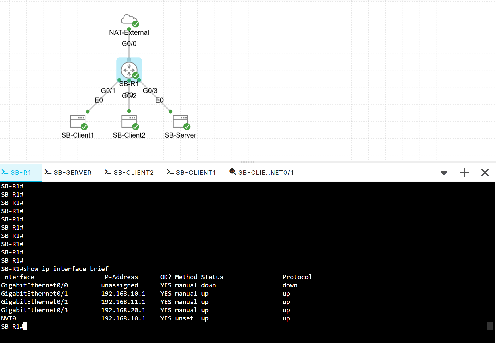
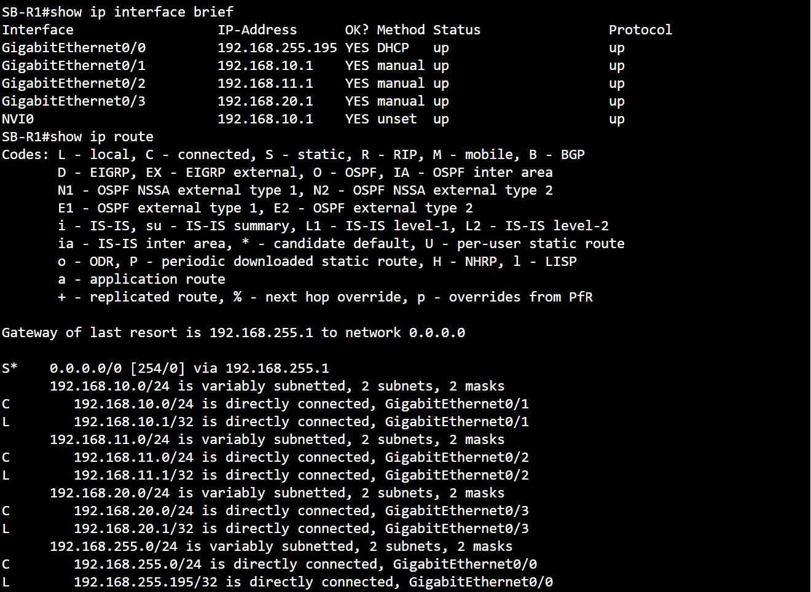
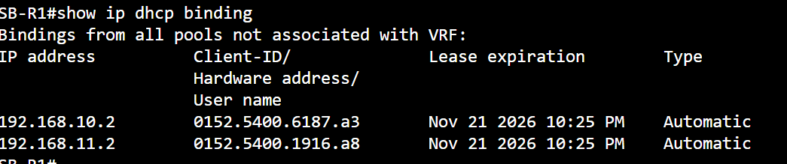
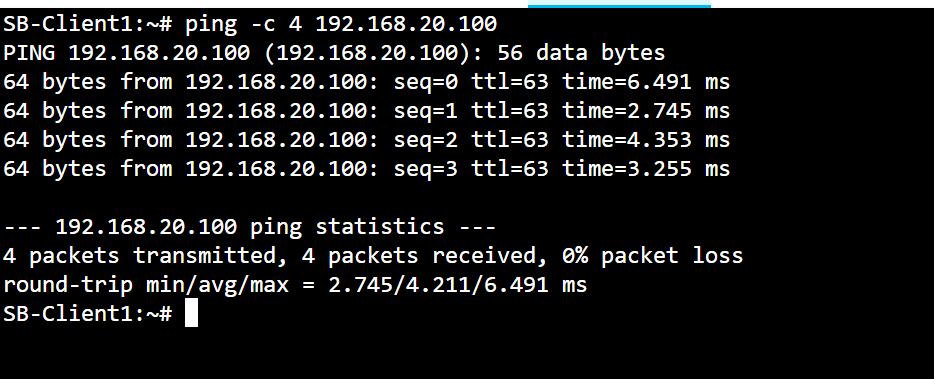
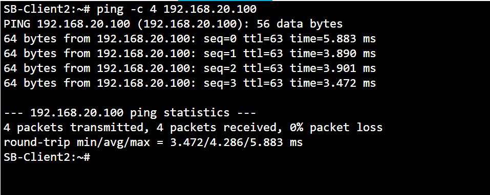
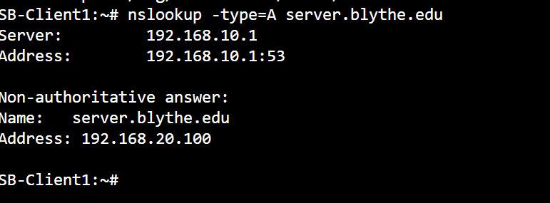
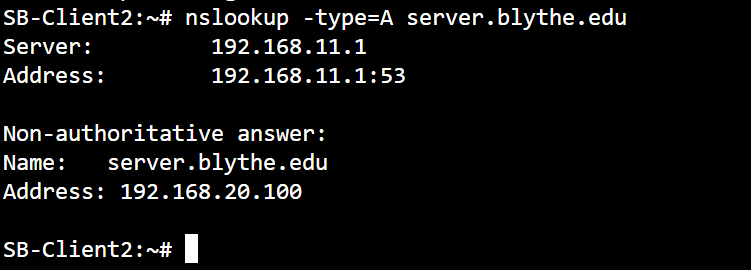
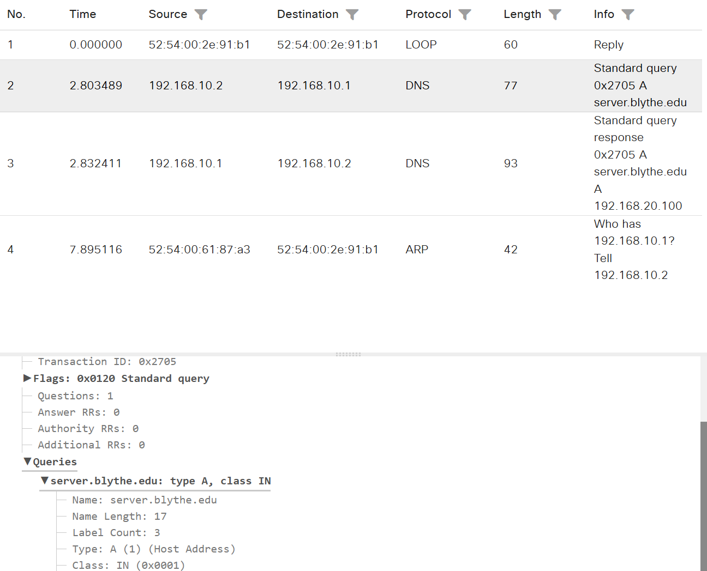

# Sprint 4 — Network Verification Report

**Course:** CS457  
**Project:** CML 1-Router Network Topology & Infrastructure Deployment  
**Student:** [Enter student name]  
**Date:** November 20, 2026  
**Router:** SB-R1

## 1. Overview and Objectives

This sprint deployed a single-router, three-subnet network in Cisco Modeling Labs (CML). Cisco IOS router **SB-R1** connects two Alpine Linux clients and a game server. The router provides inter-subnet IPv4 routing, separate DHCP pools for the clients, and DNS resolution for the game server hostname `server.blythe.edu`. An External Connector in NAT mode provides an uplink. The tests documented below verify interface status, connected routes, DHCP assignments, client-to-server connectivity, and DNS query/response traffic.

## 2. Topology and Addressing



*Figure 1. CML topology and device connections.*

| Device / interface | IPv4 address / subnet | Role |
|---|---|---|
| SB-R1 Gi0/0 | 192.168.255.195/24 (DHCP) | NAT-External uplink |
| SB-R1 Gi0/1 | 192.168.10.1/24 | Client 1 default gateway and DNS |
| SB-R1 Gi0/2 | 192.168.11.1/24 | Client 2 default gateway and DNS |
| SB-R1 Gi0/3 | 192.168.20.1/24 | Game server gateway |
| SB-Client1 | 192.168.10.2/24 (DHCP) | Client 1 |
| SB-Client2 | 192.168.11.2/24 (DHCP) | Client 2 |
| SB-Server | 192.168.20.100 (reachable; configured static address per design) | Game server |
| NAT gateway | 192.168.255.1 | Default route next hop |

Each LAN uses a separate routed router interface; no additional router or inter-router static routes are required for communication among the three LANs.

## 3. Router Interface and Routing Verification

Commands executed on SB-R1:

```cisco
show ip interface brief
show ip route
```

**Interface verification:**

```text
Interface              IP-Address       Method   Status   Protocol
GigabitEthernet0/0     192.168.255.195  DHCP     up       up
GigabitEthernet0/1     192.168.10.1     manual   up       up
GigabitEthernet0/2     192.168.11.1     manual   up       up
GigabitEthernet0/3     192.168.20.1     manual   up       up
NVI0                   192.168.10.1     unset    up       up
```

**Key routes observed:**

```text
Gateway of last resort is 192.168.255.1 to network 0.0.0.0
S* 0.0.0.0/0 [254/0] via 192.168.255.1
C  192.168.10.0/24 is directly connected, GigabitEthernet0/1
C  192.168.11.0/24 is directly connected, GigabitEthernet0/2
C  192.168.20.0/24 is directly connected, GigabitEthernet0/3
C  192.168.255.0/24 is directly connected, GigabitEthernet0/0
```

All four physical router interfaces were **up/up**. The routing table contained all three required directly connected LAN networks and a default route toward the External Connector. The uplink successfully obtained its address by DHCP. The presence of a default route verifies uplink routing configuration, but does not by itself prove successful external internet access.



*Figure 2. SB-R1 `show ip interface brief` and `show ip route`.*

**Result: PASS — Interface status and connected routing.**

## 4. DHCP Verification

Two separate DHCP pools serve the client subnets: `CLIENT1_POOL` for 192.168.10.0/24 and `CLIENT2_POOL` for 192.168.11.0/24. The expected gateway and DNS server addresses are 192.168.10.1 for Client 1 and 192.168.11.1 for Client 2.

Command executed:

```cisco
show ip dhcp binding
```

| Client | Leased address | Lease type | Expiration shown |
|---|---|---|---|
| SB-Client1 | 192.168.10.2 | Automatic | Nov 21, 2026, 10:25 PM |
| SB-Client2 | 192.168.11.2 | Automatic | Nov 21, 2026, 10:25 PM |

The router reported active automatic DHCP bindings on both required subnets. Subsequent DNS lookups also showed each client using the appropriate router-interface DNS address.



*Figure 3. SB-R1 DHCP lease verification.*

**Result: PASS — Both clients received DHCP leases on the correct subnets.**

## 5. Game Server and Cross-Subnet Connectivity

The game server was addressed as `192.168.20.100` on the server LAN, whose router interface is `192.168.20.1/24`. Both clients tested connectivity to the server using:

```sh
ping -c 4 192.168.20.100
```

| Test source | Destination | Sent | Received | Packet loss | Min / Avg / Max RTT |
|---|---|---:|---:|---:|---|
| SB-Client1 (192.168.10.2) | 192.168.20.100 | 4 | 4 | 0% | 2.745 / 4.211 / 6.491 ms |
| SB-Client2 (192.168.11.2) | 192.168.20.100 | 4 | 4 | 0% | 3.472 / 4.286 / 5.883 ms |

All eight ICMP echo requests received replies. The tests demonstrate successful routed connectivity from both client subnets to the server subnet with no observed packet loss.



*Figure 4. SB-Client1 ping to the game server.*



*Figure 5. SB-Client2 ping to the game server.*

**Result: PASS — Both clients reached the game server with 0% packet loss.**

## 6. DNS Resolution Verification

The router's DNS service resolves `server.blythe.edu` to the game server's IPv4 address `192.168.20.100`. Each client ran:

```sh
nslookup -type=A server.blythe.edu
```

| Test source | DNS server contacted | Returned hostname | Returned A record | Result |
|---|---|---|---|---|
| SB-Client1 | 192.168.10.1:53 | server.blythe.edu | 192.168.20.100 | PASS |
| SB-Client2 | 192.168.11.1:53 | server.blythe.edu | 192.168.20.100 | PASS |

Both outputs displayed a **Non-authoritative answer** and the correct IPv4 address. That wording is part of the resolver's displayed response and does not change the successful resolution result.



*Figure 6. SB-Client1 A-record lookup using 192.168.10.1.*



*Figure 7. SB-Client2 A-record lookup using 192.168.11.1.*

**Result: PASS — Both clients resolved the server hostname to 192.168.20.100.**

## 7. Wireshark DNS Packet Capture

A packet capture on the SB-Client1-to-SB-R1 connection recorded the DNS request and matching reply after the client ran `nslookup -type=A server.blythe.edu`.

| Packet | Time (s) | Source | Destination | DNS content |
|---|---:|---|---|---|
| 2 | 2.803489 | 192.168.10.2 | 192.168.10.1 | Standard query, type A, `server.blythe.edu` |
| 3 | 2.832411 | 192.168.10.1 | 192.168.10.2 | Standard response, A record `192.168.20.100` |

Both packets use transaction ID **0x2705**, linking the reply to the original request. The difference between their capture timestamps is **0.028922 seconds (28.922 ms)**. The query was sent by Client 1 to the router; the reply returned the expected game server address.



*Figure 8. Wireshark packets 2 and 3 show the DNS A query and the response containing 192.168.20.100.*

**Required raw capture file:** `sprint_4_dns_lookup.pcap` (submitted separately from this report).

**Result: PASS — DNS request and response captured and matched.**

## 8. External Connector and NAT

The CML `NAT-External` node is connected to SB-R1 GigabitEthernet0/0. That interface received `192.168.255.195` through DHCP and was **up/up**. The router installed a default route via `192.168.255.1`. This verifies the operational uplink and its default route. A separate NAT translation table or external reachability test was not included in the supplied evidence, so successful end-to-end internet access is not claimed here.

## 9. Verification Summary

| Requirement | Evidence | Status |
|---|---|---|
| Single router and three routed LANs | Topology screenshot; router interfaces | PASS |
| Router interfaces operational | `show ip interface brief` | PASS |
| Connected LAN routes and uplink default route | `show ip route` | PASS |
| DHCP address assignments for both clients | `show ip dhcp binding` | PASS |
| Client 1 can reach game server | 4/4 ping replies, 0% loss | PASS |
| Client 2 can reach game server | 4/4 ping replies, 0% loss | PASS |
| DNS resolution from Client 1 | `nslookup` returned 192.168.20.100 | PASS |
| DNS resolution from Client 2 | `nslookup` returned 192.168.20.100 | PASS |
| Wireshark DNS query and reply | Packets 2 and 3, transaction 0x2705 | PASS |
| External internet reachability | Not directly tested in supplied evidence | NOT VERIFIED |

## 10. Conclusion

The Sprint 4 CML network successfully connected two DHCP-configured client subnets and a game server subnet through one Cisco IOS router. Router interface and routing table outputs verified the three directly connected LANs and an operational DHCP-addressed NAT uplink. Both clients received valid automatic addresses, successfully reached the game server without packet loss, and resolved `server.blythe.edu` to `192.168.20.100`. Wireshark independently captured the matching DNS A query and response. The supplied evidence supports successful internal routing, DHCP allocation, and DNS resolution.

## 11. Submission Files

- `sprint_4_topology.yaml` — CML-exported topology (submit separately)
- `sprint_4_dns_lookup.pcap` — original Wireshark capture (submit separately)
- `sprint_4_network_report.md` — this report
- `sprint_4_report_images/` — screenshots referenced by the Markdown report

All required files should be committed to the public Git repository and the repository URL submitted to Canvas.
